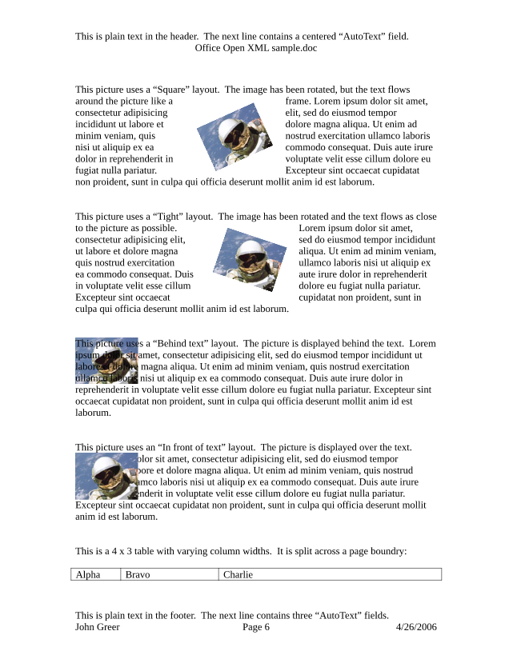
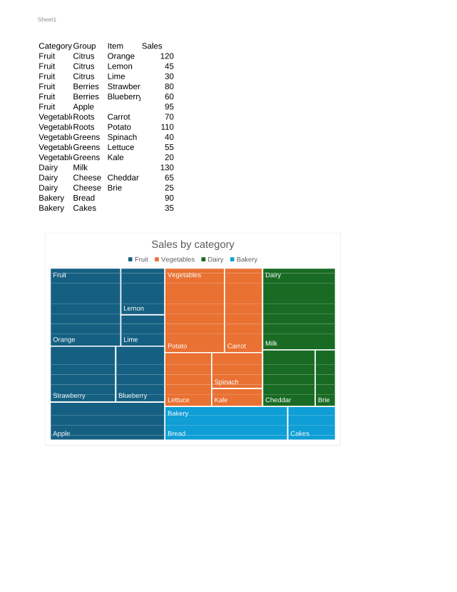
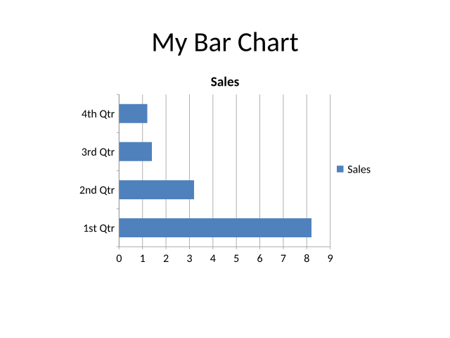
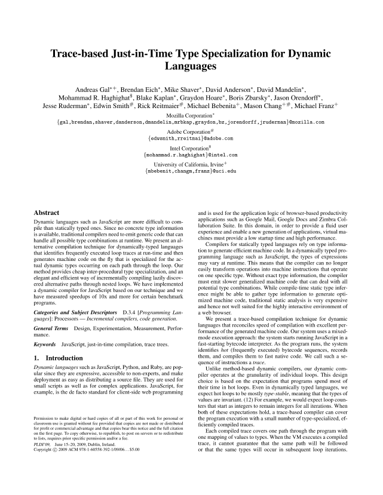
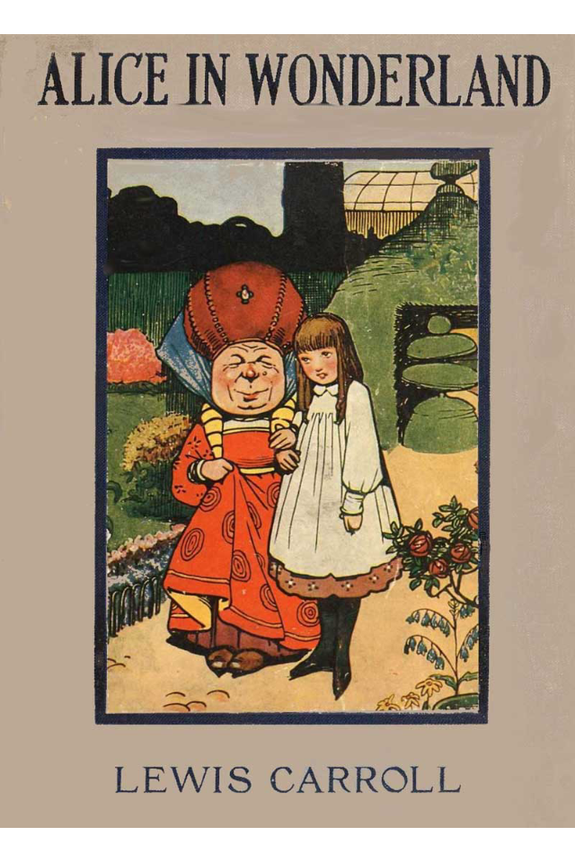
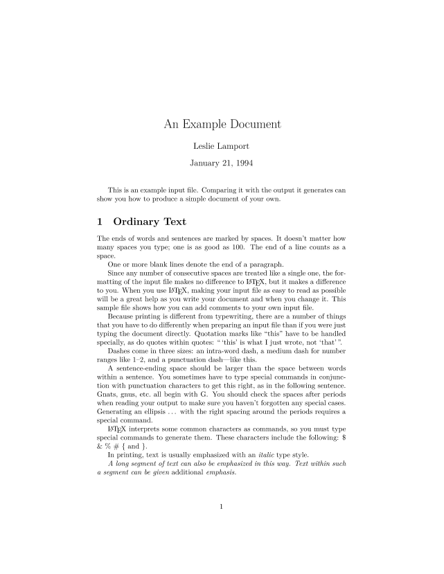
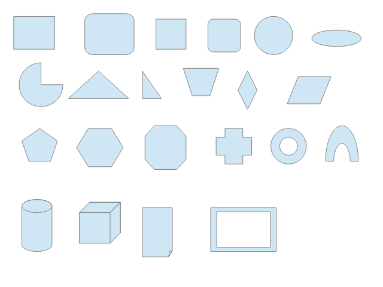
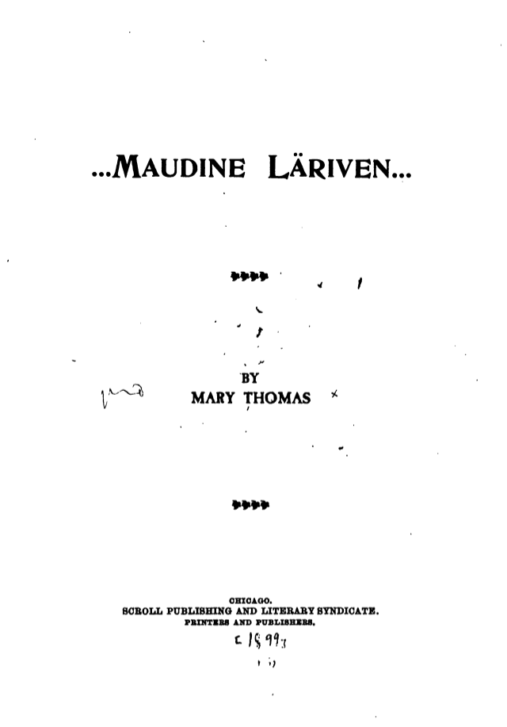

<div align="center">
  <!-- The logo of ivy comes later, at docs/logo/ivy.svg. -->
  <a href="#gallery" title="Gallery">Gallery</a> |
  <a href="#installing" title="Installing">Installing</a> |
  <a href="#using" title="Using">Using</a> |
  <a href="#packages" title="Packages">Packages</a> |
  <a href="#documents" title="Documents">Documents</a> |
  <a href="#related-projects" title="Related Projects">Related Projects</a> |
  <a href="https://pkg.go.dev/github.com/xo/ivy" title="Go Reference">Reference</a> |
  <a href="https://github.com/xo/ivy/releases" title="Releases">Releases</a> |
  <a href="CONTRIBUTING.md" title="Contributing">Contributing</a> |
  <a href="#license" title="License">License</a>
</div>

<br/>

[![Unit Tests][ivy-ci-status]][ivy-ci]
[![Go Reference][goref-ivy-status]][goref-ivy]
[![Releases][release-status]][releases]
[![Discord Discussion][discord-status]][discord]

[ivy-ci]: https://github.com/xo/ivy/actions/workflows/test.yml "Test CI"
[ivy-ci-status]: https://github.com/xo/ivy/actions/workflows/test.yml/badge.svg "Test CI"
[goref-ivy]: https://pkg.go.dev/github.com/xo/ivy "Go Reference"
[goref-ivy-status]: https://pkg.go.dev/badge/github.com/xo/ivy.svg "Go Reference"
[release-status]: https://img.shields.io/github/v/release/xo/ivy?display_name=tag "Latest Release"
[releases]: https://github.com/xo/ivy/releases "Releases"
[discord]: https://discord.gg/WDWAgXwJqN "Discord Discussion"
[discord-status]: https://img.shields.io/discord/829150509658013727.svg?label=Discord&logo=Discord&colorB=7289da&style=flat-square "Discord Discussion"

# ivy

`ivy` decodes, renders and encodes the file formats that a program shows as
images, in pure Go:

1. Ebooks: EPUB, MOBI, AZW3, FictionBook, CHM, DjVu, comic book archives and
   the other formats that calibre reads.
2. Office documents: Word, Excel and PowerPoint, OpenDocument, RTF and CSV.
3. Page descriptions: PDF, XPS, PostScript, EPS, Adobe Illustrator, EMF and
   WMF.
4. Images with layers: Photoshop, OpenRaster and Krita.
5. LaTeX and plain TeX, with a TeX engine in Go.
6. Files that carry a preview: camera RAW files, and the documents of
   Pages, Keynote and Numbers.

ivy also opens a file that a password protects, where the format has a public
method of encryption, and it writes the pages of a document of any of these
formats as a PDF file. The containers that carry an icon or a preview, such
as Apple disk images and the packages of applications for macOS, iOS,
Android, Windows and Linux, come in a later phase.

A program that imports ivy needs the Go toolchain and nothing else. ivy does
not use cgo and does not run an outside program. Each format is a package of
its own, so a program links only the formats that it imports.

ivy draws each page with [okage][okage], and a program finds the type of a
file with [magic][magic] before it calls ivy. A rendering is good enough for a
person to review the document. It is not an exact copy of the rendering of
the program that made the document.

[okage]: https://github.com/xo/okage
[magic]: https://github.com/xo/magic

## Gallery

These pages are drawn by ivy, from documents of the corpus that the review
compares with Word, Excel, PowerPoint, LibreOffice, pdfLaTeX and other
programs. `go run ./cmd/gallery` in the folder `test` draws them again.
Select a page to see it at its full size.

<table>
<tr>
<td align="center"><a href="docs/gallery/docx-office-math.png"></a><br>Word, with equations of Office Math</td>
<td align="center"><a href="docs/gallery/doc-floating-pictures.png"></a><br>Word 97, text on both sides of pictures</td>
<td align="center"><a href="docs/gallery/xlsx-treemap.png"></a><br>Excel, a sheet with a treemap</td>
</tr>
<tr>
<td align="center"><a href="docs/gallery/pptx-bar-chart.png"></a><br>PowerPoint, a slide with a chart</td>
<td align="center"><a href="docs/gallery/pdf-tracemonkey.png"></a><br>PDF, a paper in two columns</td>
<td align="center"><a href="docs/gallery/epub-alice.png"></a><br>EPUB, a book with pictures</td>
</tr>
<tr>
<td align="center"><a href="docs/gallery/tex-sample2e.png"></a><br>LaTeX, the sample of LaTeX</td>
<td align="center"><a href="docs/gallery/odp-shapes.png"></a><br>OpenDocument, a slide of shapes</td>
<td align="center"><a href="docs/gallery/djvu-title.png"></a><br>DjVu, a scanned book of 1899</td>
</tr>
</table>

The documents are from Aspose (MIT), Apache POI (Apache-2.0), ivy (MIT),
pdf.js (Apache-2.0), Project Gutenberg (public domain), the LaTeX project
(LPPL-1.3c), LibreOffice (MPL-2.0) and the Internet Archive (public
domain).
`test/review/corpus.tsv` names the source and the license of each one.

## Installing

Each format is a package of its own. Add the root package and the formats
that a program opens:

```sh
go get github.com/xo/ivy@latest
```

A program that renders Office documents or LaTeX also adds the module of
the fonts:

```sh
go get github.com/xo/ivy/fonts@latest
```

## Using

A program opens a file with the package of its format. A document gives
the capabilities that its format has: `ivy.Pager` gives the pages,
`ivy.Describer` gives the title and the authors, and `ivy.Previewer` gives
the previews that the file holds. A Document is safe for concurrent use.

### Draw the pages of a file

This program draws each page of a Word document as a PNG file, at 96 dots
for each inch. An `io.SectionReader` of the file gives the size that
`ivy.Source` needs.

```go
package main

import (
	"context"
	"fmt"
	"image/color"
	"image/png"
	"io"
	"log"
	"os"

	"github.com/xo/ivy"
	"github.com/xo/ivy/docx"
	"github.com/xo/ivy/fonts"
)

func main() {
	ctx := context.Background()
	f, err := os.Open("report.docx")
	if err != nil {
		log.Fatal(err)
	}
	defer f.Close()
	fi, err := f.Stat()
	if err != nil {
		log.Fatal(err)
	}
	cfg := ivy.Config{Fonts: fonts.FS()}
	doc, err := docx.Open(ctx, io.NewSectionReader(f, 0, fi.Size()), docx.WithConfig(cfg))
	if err != nil {
		log.Fatal(err)
	}
	defer doc.Close()
	n := 0
	for page, err := range ivy.Pages(ctx, doc) {
		if err != nil {
			log.Fatal(err)
		}
		img, err := ivy.RenderImage(ctx, page, 96, color.White)
		if err != nil {
			log.Fatal(err)
		}
		out, err := os.Create(fmt.Sprintf("page-%03d.png", n+1))
		if err != nil {
			log.Fatal(err)
		}
		if err := png.Encode(out, img); err != nil {
			log.Fatal(err)
		}
		if err := out.Close(); err != nil {
			log.Fatal(err)
		}
		n++
	}
	fmt.Println(n, "pages")
}
```

`ivy.RenderPages` draws several pages at the same time, on all the CPUs.
`Page.Render` draws a page onto an `okage.Pixmap` with any transform, such
as a part of a page for a viewer that zooms.

### Open a file of any format

ivy holds no registry of formats, so that a program links only the formats
that it imports. Each package exports a `Format` value with its name, its
mime types, its extensions and a function that opens it. A program builds
its own registry:

```go
formats := []ivy.Format{docx.Format, xlsx.Format, pptx.Format, pdf.Format, epub.Format}
byExt := make(map[string]ivy.Format)
for _, f := range formats {
	for _, ext := range f.Exts {
		byExt[ext] = f
	}
}
format, ok := byExt[strings.TrimPrefix(filepath.Ext(name), ".")]
if !ok {
	return fmt.Errorf("%s: no format", name)
}
doc, err := format.Open(ctx, src, cfg)
```

A program can find the type of a file from its bytes with
[magic][magic], and look up the mime type in `Mimes`.

### Read the metadata and the previews

```go
if desc, ok := doc.(ivy.Describer); ok {
	info, err := desc.Describe(ctx)
	if err != nil {
		return err
	}
	fmt.Println(info.Title, info.Authors, info.Modified)
}
// The preview that is closest to 512 by 512 pixels, or a larger one.
img, err := ivy.BestPreview(ctx, doc, image.Pt(512, 512))
```

`BestPreview` returns `ivy.ErrNoPreview` when the file holds no preview. A
document that has no pages, such as a camera RAW file, gives only its
previews.

### Open a file that a password protects

```go
cfg := ivy.Config{Password: "secret"}
doc, err := pdf.Open(ctx, src, pdf.WithConfig(cfg))
if errors.Is(err, ivy.ErrPassword) {
	// the password is missing or wrong
}
```

`Config.PasswordFunc` asks for the password instead, one attempt at a time.

### Choose the paper of a text or an ebook

A text file, an HTML file, Markdown and an ebook have no page of their
own. `Config.Paper` gives the page, and US Letter is the default:

```go
cfg := ivy.Config{Paper: ivy.A4, Fonts: fonts.FS()}
book, err := epub.Open(ctx, src, epub.WithConfig(cfg))
```

### Write a PDF file

The package `pdf/pdfenc` writes the pages of a document of any format as a
PDF file. The text stays text, the links and the outline stay, and the
metadata of the document becomes the information of the file:

```go
out, err := os.Create("report.pdf")
if err != nil {
	return err
}
defer out.Close()
if err := pdfenc.Encode(ctx, out, doc); err != nil {
	return err
}
```

### Set a LaTeX document

The package `latex` reads its classes, its packages and the fonts of TeX
from `Config.TeX`, and its figures and its bibliography from the folder of
the document. `WithName` gives the job name, so that the engine reads
`report.bbl`:

```go
cfg := ivy.Config{TeX: fonts.TeX(), Fonts: fonts.FS()}
doc, err := latex.Open(ctx, src,
	latex.WithConfig(cfg),
	latex.WithDir(os.DirFS("paper")),
	latex.WithName("report"),
)
```

A program that gives a tree of a TeX distribution, such as
`os.DirFS("/usr/share/texmf-dist/tex")`, can set more classes and packages.

### Limit the work on a file

A file never crashes ivy or makes it hang. `Config.Limits` bounds the
memory, the pixels, the objects and the depth of one document, and the
context stops the work:

```go
cfg := ivy.Config{Limits: ivy.Limits{MaxMemory: 256 << 20, MaxPixels: 1 << 26}}
ctx, cancel := context.WithTimeout(ctx, 30*time.Second)
defer cancel()
```

A zero field takes the default of ivy.

### The fonts

The module `github.com/xo/ivy/fonts` holds Liberation Sans, Serif and Mono,
Carlito and Caladea, which have the metrics of Arial, Times New Roman,
Courier New, Calibri and Cambria. With `ivy.Config{Fonts: fonts.FS()}`,
lines and pages break as they do in Office. The module also holds Droid
Sans Fallback, under the Apache License 2.0, which draws the Chinese,
Japanese and Korean characters that a document does not embed. It also
holds the Noto fonts of 18 scripts, such as Arabic, Devanagari and Thai,
for the characters that the other fonts do not draw (D74).
`fonts.TeX()` gives Latin Modern, the fonts of TeX, under the GUST Font
License, for `Config.TeX` and the package `latex`. The module adds about
19.1 MB to a program. `Config.SystemFonts` also lets ivy use the fonts of
the system.

### Convert the colors of an image

The package `github.com/xo/ivy/icc` is not a format. It converts the
colors of an image to sRGB with the ICC profile of the image, with the CMYK
profile of ivy, or with the CICP code points of an AVIF or a HEIC file
(D61):

```go
out, err := icc.ToSRGB(ctx, img, profile, icc.Perceptual)
```

The documentation of each package on
[pkg.go.dev](https://pkg.go.dev/github.com/xo/ivy) has examples that run.

## Packages

These packages open a file and give its previews, its pages or both:

| Package | Formats |
| --- | --- |
| `github.com/xo/ivy/odf` | OpenDocument, with a password: the pages of the texts, the spreadsheets, the presentations and the drawings, and the thumbnail |
| `github.com/xo/ivy/docx` | Word, with a password: the pages, the thumbnail and the properties |
| `github.com/xo/ivy/xlsx` | Excel, with a password: every sheet on pages, as printing does, the thumbnail and the properties. The cells show the values that the file holds, and no formula is computed |
| `github.com/xo/ivy/pptx` | PowerPoint, with a password: one page for each slide that is not hidden, the thumbnail and the properties |
| `github.com/xo/ivy/rtf` | RTF: the pages, and the title, the author and the dates of `\info` |
| `github.com/xo/ivy/iwork` | Pages, Keynote and Numbers: the previews |
| `github.com/xo/ivy/ora` | OpenRaster and Krita: the image and the thumbnail |
| `github.com/xo/ivy/ps` | PostScript and EPS: the pages, through an interpreter of PostScript (D29), the TIFF and EPSI previews of EPS, and the title and the creator |
| `github.com/xo/ivy/camera` | The RAW files of cameras: the JPEG images, the camera and the date |
| `github.com/xo/ivy/comic` | CBZ and CBT: the pages and the cover |
| `github.com/xo/ivy/psd` | Photoshop: the image and the thumbnail |
| `github.com/xo/ivy/xps` | XPS and OpenXPS: the pages, the thumbnail, and the title and the authors |
| `github.com/xo/ivy/pdf` | PDF, with its password, and Illustrator compatible with PDF: the pages, the thumbnails, and the document information |
| `github.com/xo/ivy/epub` | EPUB 2, EPUB 3 and kepub: the pages, the cover, and the title and the authors |
| `github.com/xo/ivy/mobi` | MOBI, PRC, AZW, AZW3 and AZW4: the pages, the cover, and the title and the authors |
| `github.com/xo/ivy/fb2` | FictionBook 2, also in a zip archive: the pages, the cover, and the title and the authors |
| `github.com/xo/ivy/chm` | Compiled HTML Help: the pages, the title and the language |
| `github.com/xo/ivy/html` | HTML and HTMLZ: the pages, the cover of an HTMLZ file, and the title |
| `github.com/xo/ivy/text` | Text and TXTZ: the pages, the cover of a TXTZ file, and the metadata of a TXTZ file |
| `github.com/xo/ivy/msdoc` | Word 97 to 2003, .doc and .dot, with a password: the pages, the thumbnail, and the title, the author and the dates |
| `github.com/xo/ivy/msxls` | Excel 97 to 2003 and Excel 5, .xls and .xlt, with a password: every sheet on pages, the thumbnail and the properties |
| `github.com/xo/ivy/msppt` | PowerPoint 97 to 2003, .ppt, .pps and .pot, with a password: one page for each slide, with its texts, the thumbnail and the properties |
| `github.com/xo/ivy/vsdx` | Visio: the pages, the thumbnail and the properties of .vsdx, .vsdm, .vstx and .vstm. The thumbnail and the properties of .vsd, .vst, .vss and the stencils |
| `github.com/xo/ivy/pub` | Publisher: the thumbnail and the properties |
| `github.com/xo/ivy/csv` | CSV, TSV and TAB: the rows as one table on pages |
| `github.com/xo/ivy/djvu` | DjVu, single and bundled: the pages, the thumbnails, and the title, the authors and the dates of the metadata |
| `github.com/xo/ivy/emf` | EMF, EMF+ and WMF, also compressed as EMZ and WMZ: the page, and the program and the title of an EMF file |
| `github.com/xo/ivy/markdown` | Markdown, with the extensions of GitHub: the pages and the title |
| `github.com/xo/ivy/latex` | LaTeX and plain TeX: the pages, set by a copy of the TeX engine of go-tex/engine, with the math, the figures in PNG, JPEG, PDF, EPS and SVG, and the title and the author. A program gives the classes and the packages with the field `TeX` of `ivy.Config` |

Two packages are not formats. `github.com/xo/ivy/pdf/pdfenc` writes the
pages of a document of any of these formats as a PDF file (D58), and
`github.com/xo/ivy/icc` converts the colors of an image to sRGB (D61).

[`docs/FORMATS.md`](docs/FORMATS.md) lists each format that ivy can
support, the way to support it, its source and its cost.
[`docs/PLAN.md`](docs/PLAN.md) gives the order of the work.

## Documents

| Document | What it holds |
| --- | --- |
| [docs/PLAN.md](docs/PLAN.md) | the plan, the architecture, the testing plan, the phases and the open questions |
| [docs/API.md](docs/API.md) | the design of the public API and the expected layout of the packages |
| [docs/FORMATS.md](docs/FORMATS.md) | the survey of the formats, with the estimates of three outside models |
| [docs/BACKLOG.md](docs/BACKLOG.md) | the work that is known and not done, and the work for okage, magic and iv |
| [docs/UPSTREAM.md](docs/UPSTREAM.md) | the rules for code that ivy copies or ports |
| [docs/decisions/](docs/decisions/README.md) | every decision, one file each, with an index |
| [CONTRIBUTING.md](CONTRIBUTING.md) | how to change ivy |
| [AGENTS.md](AGENTS.md) | the rules for a coding agent, which also hold for a person |

## Related projects

`ivy` is one of the `xo` projects. Several of them port a library of C or
Rust to pure Go. Each one is a separate repository:

| Project | What it is |
| --- | --- |
| [okage](https://github.com/xo/okage) | A Go port of tiny-skia and resvg, which draws 2D graphics and SVG images. ivy draws with it |
| [magic](https://github.com/xo/magic) | A Go port of libmagic, which identifies the type of a file |
| [transit](https://github.com/xo/transit) | A Go port of tree-sitter, a parser of source code |
| [rline](https://github.com/xo/rline) | A readline package for Go, which reads a line of text that a person edits. It started as a port of isocline |
| [zuzu](https://github.com/xo/zuzu) | Draws DOT graphs, Mermaid diagrams, and Vega and Vega-Lite charts |
| [ox](https://github.com/xo/ox) | Parses the flags and arguments of a command line |
| [usql](https://github.com/xo/usql) | A command line client for SQL and NoSQL databases |

[iv](https://github.com/kenshaw/iv), an image viewer for the terminal, is the
first program that uses ivy. ivy replaces the outside programs and the
libraries that iv uses through cgo for ebooks, XPS, Office documents, PDF and
HTML.

## License

The code of ivy is under the MIT license, in `LICENSE`. A package that ivy
copies or ports from another project keeps the license of that project, in a
`LICENSE` file in its folder. `psd/internal/oovpsd` is a copy of
github.com/oov/psd, under the MIT license.
